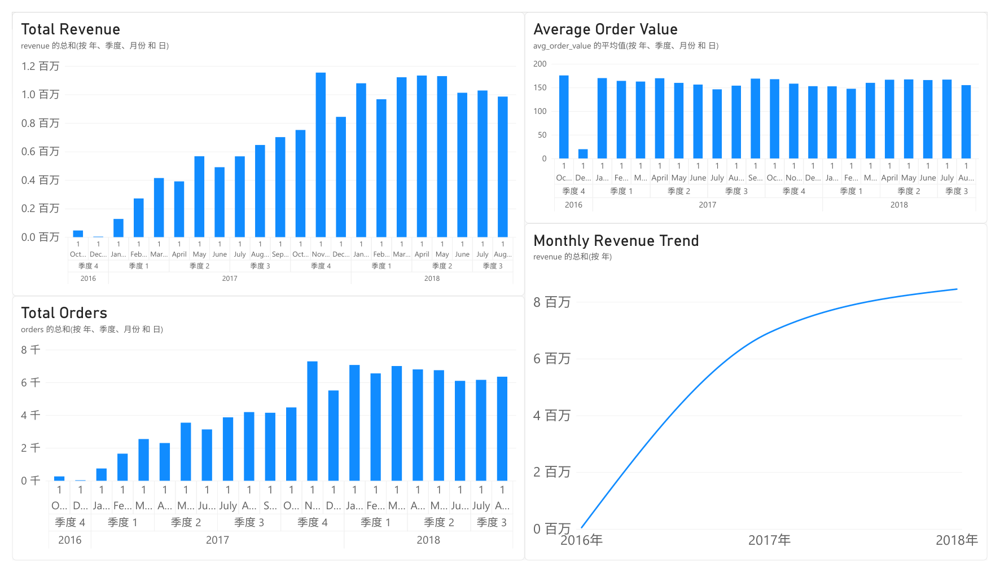
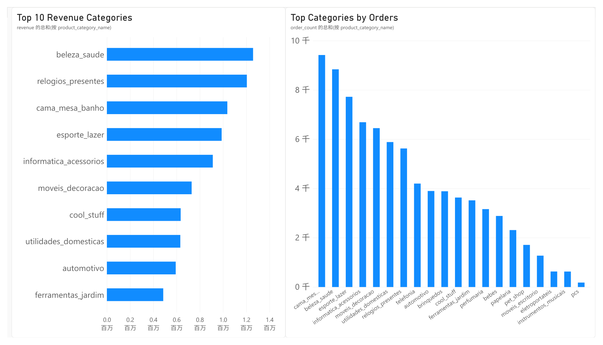
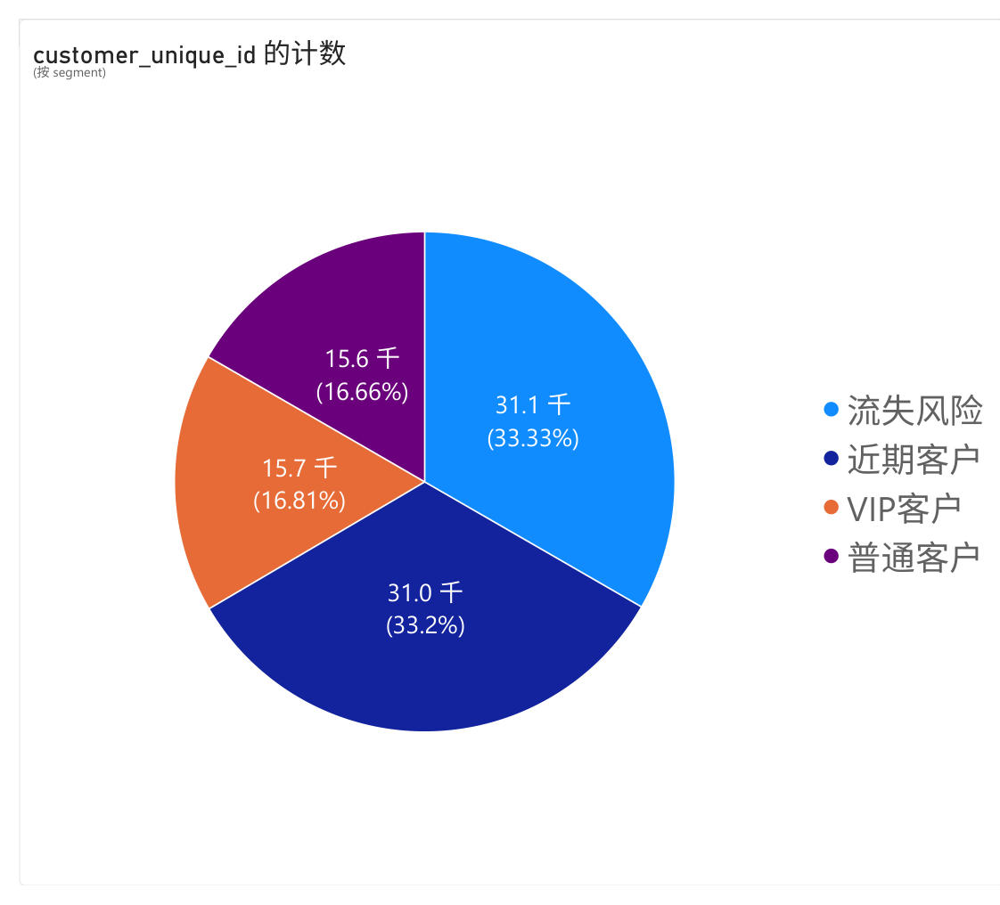

# 电商经营分析与用户价值分群

基于 **Olist 巴西电商公开交易数据**（99,441 笔订单 / 93,357 名客户 / 15.0M 交易额）搭建的完整数据分析项目：用 DuckDB 建库、SQL 完成业务取数、Python 建模分群、Power BI 输出交互看板，最终沉淀为一份可落地的大促与客户运营建议报告。

> 完整洞察报告见 [`report/business_insights(中).md`](report/business_insights(中).md)

---

## 核心结论

| # | 结论 | 支撑证据 |
|---|------|---------|
| 1 | **一半客户贡献八成收入**，且高价值客户正在流失 | 高价值两群占 50.1% 客户、80.8% 收入；其中「重要保持客户」平均 363 天未复购，仍持有 39.7% 历史收入 |
| 2 | **复购率仅 3.0%**，F 维度在该数据集上失效 | 97.0%（90,556 人）仅购买一次，频次维度无区分度，客户分群改用 R-M 二维 |
| 3 | **黑五是「以量换价」型大促**，不是量价齐升 | 单日收入为 11 月日均的 5.2 倍、单量为 5.4 倍，但客单价反降 4.1%；100 元以下订单占比升 3.6pp，500 元以上降 1.0pp |
| 4 | **家居 / 美妆 / 礼品类最依赖大促**，运动休闲与手表几乎无弹性 | 大促周收入相对 10 月周均：家具装饰 3.99 倍、香水 3.96 倍、美容健康 3.93 倍；运动休闲 1.99 倍、手表礼品 2.58 倍 |
| 5 | **大促推高分期渗透，资金成本被低估** | 黑五当日平均分期 3.51 期（平时 2.86 期），6 期以上占比 22.93%（平时 15.36%，+7.6pp） |

---

## Power BI 看板

三页交互式看板，分别回答三个问题：整体经营健康度、钱从哪些品类来、客户该怎么分层运营。

| 01 经营总览 | 02 商品表现 | 03 客户分层 |
|:---:|:---:|:---:|
|  |  |  |
| 收入趋势、订单量、客单价 | 品类收入排名与订单分布 | RFM 分群结构与召回优先级 |

> 看板源文件：`bi/电商数据看板.pbix`（需 Power BI Desktop 打开）｜免安装预览：[电商数据看板.pdf](bi/电商数据看板.pdf)

---

## 数据集

[Brazilian E-Commerce Public Dataset by Olist](https://www.kaggle.com/datasets/olistbr/brazilian-ecommerce)

数据区间 2016-09 至 2018-08，实际使用 6 张表：

| 表 | 行数 | 说明 |
|---|---|---|
| orders | 99,441 | 订单主表（状态、下单时间） |
| order_items | 112,650 | 订单商品明细（价格、运费） |
| payments | 103,886 | 支付记录（金额、分期层数） |
| customers | 99,441 | 客户信息（含去重后的 customer_unique_id） |
| products | 32,951 | 商品属性与品类 |
| reviews | 99,224 | 订单评价 |

> 数据文件体积 62MB，未纳入版本控制。按下方「如何运行」自行下载到 `data/` 即可。

---

## 技术栈

- **数据库**：DuckDB（列式存储，直接查询 CSV，免部署）
- **分析语言**：SQL（窗口函数、CTE、多表关联）
- **建模**：Python（Pandas、RFM 分群）
- **可视化**：Power BI（三页交互看板）
- **AI 辅助**：用于生成分析假设与整理报告措辞，所有结论均由数据计算得出

---

## 项目结构

```
AI-Ecommerce-Analytics/
├── data/                     原始 CSV（未纳入版本控制）
├── sql/                      业务取数脚本
│   ├── sales_analysis.sql        销售表现
│   ├── customer_analysis.sql     客户复购
│   ├── product_analysis.sql      商品表现
│   ├── rfm_analysis.sql          RFM 基础聚合
│   └── promo_analysis.sql        大促脉冲专题（5 段查询）
├── python/
│   ├── setup_database.py          CSV → DuckDB 建库
│   ├── first_analysis.py          首轮探索
│   ├── customer_analysis.py       复购与客户指标
│   ├── product_analysis.py        品类表现
│   ├── customer_segmentation.py   RFM 分群（初版）
│   ├── rfm_segmentation_v2.py     R-M 二维分群（修正版）
│   └── promo_analysis.py          大促脉冲分析
├── bi/
│   └── 电商数据看板.pbix          Power BI 看板
├── images/                    看板截图
├── output/                    分析结果 CSV
├── report/                    业务洞察报告（中 / 英）
├── readme/                    项目说明（中 / 英）
├── ai/                        AI 辅助洞察记录
└── requirements.txt
```

---

## 如何运行

```bash
# 1. 下载数据
#    从上方 Kaggle 链接下载，解压后把 6 个 CSV 放入 data/

# 2. 安装依赖
pip install -r requirements.txt

# 3. 建库（CSV → DuckDB）
python python/setup_database.py

# 4. 大促脉冲分析（导出 5 份结果到 output/）
python python/promo_analysis.py

# 5. 客户分群（导出客户级明细与分群汇总）
python python/rfm_segmentation_v2.py

# 6. 打开看板
#    用 Power BI Desktop 打开 bi/电商数据看板.pbix
```

所有脚本以 `read_only=True` 连接数据库，不会修改 `ecommerce.duckdb`。

---

## 两处方法论说明

这两点是本项目与常见教程式分析的主要差别。

### 1. 为什么不用 F 维度做客户分群

该数据集 97.0% 的客户只购买一次，`frequency` 几乎全为 1。若强行按频次分 5 档，等于把完全相同的客户按行号随机切分，分群结果不可复现，也无法解释。

因此本项目将 F 降级为诊断指标，改用 **R（最近购买）× M（累计消费）** 二维、以中位数为界划分四个象限，每段对应明确的运营动作：

| 客群 | 特征 | 运营动作 |
|---|---|---|
| 重要价值客户 | 近期购买、消费高（25.6% 人数 / 41.1% 收入） | 复购激励 + 品类连带，防止转入沉睡 |
| 重要保持客户 | 沉睡但消费高（24.6% 人数 / 39.7% 收入） | 召回优先级最高，人均历史贡献是一般挽留客户的 4.2 倍 |
| 一般发展客户 | 活跃但消费低（24.5% 人数 / 9.3% 收入） | 提升客单与连带 |
| 一般挽留客户 | 低活跃低消费（25.4% 人数 / 9.8% 收入） | 不做付费召回，仅自然渠道低成本覆盖 |

初版按 F 分群时，「流失风险 33.33%」把高价值与低价值流失混为一谈，掩盖了两者 4.2 倍的人均价值差 —— 召回预算会投错人。

### 2. 数据质量处理

- **2016-09 与 2016-12 各仅 1 笔订单**，属数据源缺口。若不剔除，趋势图会显示「销售暴跌再暴涨」，是典型的数据误读。趋势分析中已用 `HAVING` 过滤。
- **品类弹性分析过滤了基数过小的长尾品类**（10 月周均收入 < 2,000）。不加门槛时，`agro_industria_e_comercio` 会出现 13.95 倍的虚高倍数，实际其周均收入仅 756 元，属小样本噪声。

---

## 局限说明

- 数据为巴西市场 2016–2018 年，品类结构与消费习惯与国内电商存在差异，结论不宜直接迁移
- 缺少流量与投放成本数据，无法计算 ROI、CAC、LTV 等效率指标，分析止于收入结构与客户分层
- 缺少库存与履约数据，大促备货建议为方向性判断，未做库存优化建模
- 单次购买占比过高限制了 RFM 的完整应用，这是数据本身的特性，不是方法选择问题

---

## 作者

北木楠 · 数学与应用数学 · 2027 届
